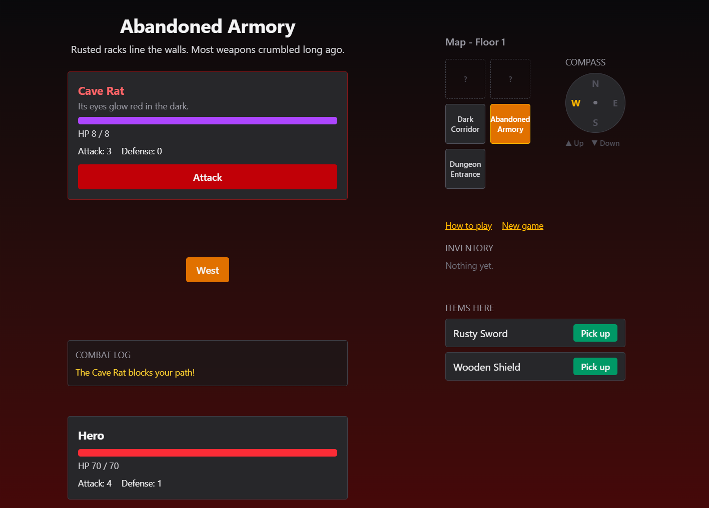

# Dungeon Crawler

**A text-based RPG built with React. Explore two floors, fight turn-based battles, find keys and survive the drowned depths.**

[](https://dungen-crawler-text-rpg.vercel.app/)




## About

Dungeon Crawler is a browser game with no backend and no canvas: everything is React state, plain data and regular DOM elements. You move between rooms, collect gear, unlock doors and fight your way down to the final boss. Your progress saves automatically in the browser.

I built it to learn React properly: state, props, derived data, effects and clean project structure, with the game rules kept separate from the interface.

## Features

- **Two floors, ten rooms** connected by exits and stairs, with locked doors that need the right key
- **Turn-based combat** against eight enemies, with damage based on attack and defense, plus a hit shake animation
- **Idle attacks**: stay in a room with a living enemy and it loses patience and strikes
- **Inventory and gear** that changes your stats, plus consumable potions
- **Minimap** that sizes itself from the room data, shows the current floor and hides unexplored rooms behind a `?`
- **Compass** that lights up the directions you can actually walk in, including stairs
- **Per-room backgrounds** that cross-fade as you move
- **Combat log** with varied messages
- **Autosave** with `localStorage`, plus a New Game button
- **First-visit tutorial** that remembers who has already seen it
- Victory and game over screens

## How to play

1. Use the direction buttons to move between rooms. Unexplored rooms appear as `?` on the map.
2. Pick up items. Weapons raise Attack, armor raises Defense, potions restore health.
3. Press **Attack** to fight. Damage is the attacker's Attack minus the target's Defense, and always at least 1.
4. Some doors are locked. Find the right key.
5. Defeat the final boss to win.

## Tech stack

| Area | Tools |
|---|---|
| UI | React |
| Build tool | Vite |
| Styling | Tailwind CSS |
| Persistence | Browser `localStorage` |
| Hosting | Vercel |

## Project structure

```
src/
├── components/   UI only: panels, buttons, overlays (MiniMap, EnemyPanel, Inventory, ...)
├── data/         Game content as plain data: rooms, items, enemies, player
├── game/         Pure game logic: combat, stats, doors, map sizing, messages, storage
├── ui/           Room background themes
├── App.jsx       Game state and event handlers
└── main.jsx
```

## Design decisions

- **Data, logic and UI are separate.** Rooms, items and enemies are plain objects. Rules like `calculateDamage` or `getMapSize` are pure functions with no React in them. Components only display things and report clicks.
- **Derived state over stored state.** The state holds only what cannot be worked out: current room, visited rooms, inventory, health. Everything else, such as the room's remaining items, your attack and defense, whether an enemy is defeated or the game is won, is calculated on each render.
- **Adding content is only data.** A new room, enemy or item needs no logic changes. The minimap resizes, the compass updates and the background layers appear on their own.
- **Safe persistence.** Loading a save is wrapped in `try/catch` with defaults, so a broken or old save cannot crash the game. The tutorial flag lives under its own key, so resetting the game does not bring it back.
- **Timers with cleanup.** The idle attack uses an effect that cancels and restarts its timer whenever the player acts.

### Adding a room

```js
cellar: {
  id: "cellar",
  name: "Flooded Cellar",
  description: "Rotting barrels float in knee-deep water.",
  floor: 2, x: 1, y: 1, theme: "cellar",
  exits: { west: "landing", north: "archive", east: "throne" },
  locks: { east: "silver_key" },
  itemIds: ["iron_shield"],
  enemyId: "armored_crab",
},
```

## Run locally

```bash
git clone https://github.com/G0dWarri0r/Text-RPG-game.git
cd Text-RPG-game
npm install
npm run dev
```

Build for production with `npm run build`.

## Roadmap

- [ ] Equip system: one weapon and one armor at a time
- [ ] Validate saved games before loading them
- [ ] Move game state into a custom `useGame` hook
- [ ] XP and levels
- [ ] More floors

## Author

Built by [@G0dWarri0r](https://github.com/G0dWarri0r).
